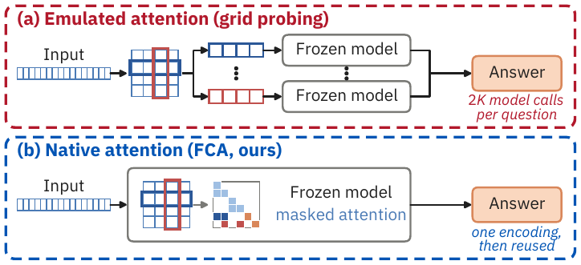
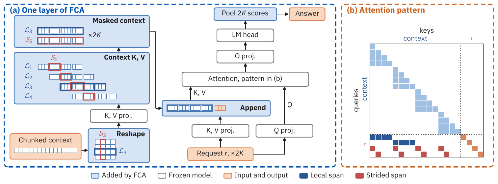
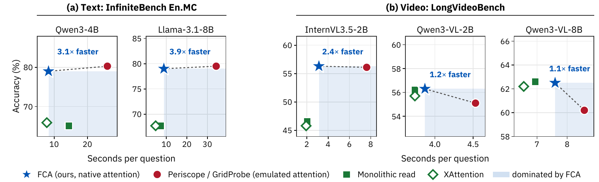
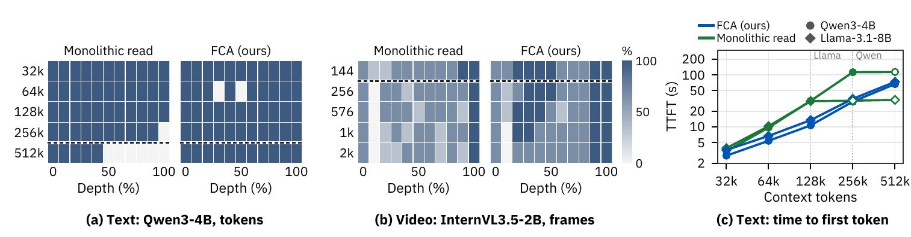
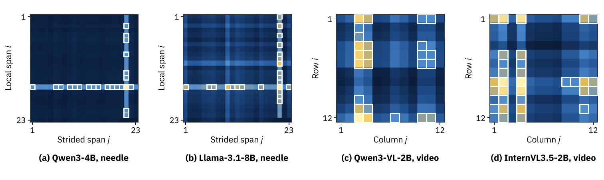

# Factorized Context Attention: From Emulated to Native Grid Probing
**Authors:** [Mohamed Eltahir](https://www.linkedin.com/in/mohammad2012191/), [Manar Eyad](https://www.linkedin.com/in/manar-eyad-b9185a2a7/), [Yara Alzahrani](https://www.linkedin.com/in/yara-alzahrani-a196a329a/), [Fatimah Albesher](https://www.linkedin.com/in/fatimah-albesher-4a4179369/), [Duaa M. Tahir](https://www.linkedin.com/in/duaatahir5/), [Tanveer Hussain](https://www.linkedin.com/in/tinu445/) and [Naeemullah Khan](https://www.linkedin.com/in/profkhan/). 

<div align="center">

[](https://arxiv.org/abs/2611.32423)

</div>

<div align="center">
  
  <p><em>Emulated against native attention. (a) Grid probing builds the grid outside the frozen model and calls the model once per span. (b) FCA passes the input once and selects the spans inside the model with masked attention.</em></p>
</div>

---

## Highlights
- **Grid probing is attention in disguise.** Grid probing ([Periscope](https://github.com/mohammad2012191/Periscope) on text, [GridProbe](https://github.com/mohammad2012191/GridProbe) on video, [AnswerMap](https://github.com/sanataff/AnswerMap) on images) asks a frozen model the same question about short local and strided spans of the input. Each probe only decides which part of the input the question may attend to, which is what an attention mask does. FCA runs that same pattern inside the attention layers of the model.
- **One encoding, reused.** FCA encodes the input once into a key-value store and reads all 2K spans as masked sequences in one batched forward. A later question about the same input reuses the store, so it costs a fraction of the first.
- **Accuracy and reach of grid probing at a fraction of its cost.** FCA matches grid probing on long video, long text and image grounding, gains about 10 points over the single pass on long video and 9 to 14 points on long novels, and answers a later question in as little as a tenth of the time of grid probing.
- **Beyond the context window.** A stair position schedule keeps every span inside the trained position range, so FCA finds needles in videos of over a thousand frames and in texts four times the length of the window.
- **Evidence map at no extra cost.** The 2K span scores give a K×K map of where the evidence sits, and the select read-out reads the top blocks again to answer.
- **Training-free.** FCA runs on existing frozen language and vision-language models from Hugging Face (Qwen3, Llama-3.1, Qwen3-VL, InternVL3.5) and changes no weights.

---

## News
- [2026-11] arXiv preprint and code released.

---

## Method
<div align="center">
  
  <p><em>One layer of FCA. (a) The chunked context is reshaped into a K×K grid, whose rows are local spans and whose columns are strided spans, and its keys and values are stored once. A request reads each span as a masked context, in 2K sequences that run in one batch and whose scores are pooled into the answer. (b) The resulting attention pattern for K=4.</em></p>
</div>

FCA works in two steps.

1. **Encode once.** The input is cut into blocks on a K×K grid. Each block is encoded once along its row (its local span), at stair positions, and its keys and values go into a store.
2. **Read the spans.** A request runs 2K short sequences in one batch, one per row and one per column of the grid. Each sequence attends to the stored keys and values of its span and to a copy of the request. The 2K scores are pooled into the answer (**direct** read-out), or the top blocks of the evidence map are read once more (**select** read-out).

---

## Results

<div align="center">
  
  <p><em>Accuracy against time, one panel per model. Time is the mean per question, where a read that reuses its encoding of a context pays for that encoding once. The dashed link gives the speed-up of FCA over the emulated read.</em></p>
</div>

**Long video.** 144 frames on one A100. Time is the time to first token per LongVideoBench question, for the first question on a video and for a later one.

| Model | Read | LongVideoBench | Video-MME long | First (s) | Later (s) |
|---|---|---|---|---|---|
| InternVL3.5-2B | Monolithic | 46.4 | 44.8 | 3.67 | 3.67 |
| | GridProbe | 56.1 | 46.8 | 7.62 | 7.62 |
| | **FCA** (select) | **56.3** | 45.8 | 4.45 | **1.72** |
| Qwen3-VL-2B | Monolithic | 56.2 | 47.1 | 6.40 | 6.40 |
| | GridProbe | 55.1 | 46.7 | 4.53 | 4.53 |
| | **FCA** (select) | **56.3** | **47.3** | 5.05 | **2.60** |

**Long text.** InfiniteBench En.MC, all 229 questions, on one A100. Time is the time to first token of a request inside the window.

| Model | Read | Accuracy | First (s) | Later (s) |
|---|---|---|---|---|
| Qwen3-4B | Monolithic | 65.5 | 42.2 | 42.2 |
| | Periscope (select) | 80.3 | 19.3 | 19.3 |
| | **FCA** (select) | 79.0 | **14.8** | **2.9** |
| Llama-3.1-8B | Monolithic | 67.7 | 19.8 | 19.8 |
| | Periscope (direct) | 80.8 | 16.6 | 16.6 |
| | **FCA** (direct) | 80.3 | **9.8** | **1.1** |

<div align="center">
  
  <p><em>Needles by length and depth. Accuracy (%) of the monolithic read and of FCA, three needles per cell, with a dashed line at the window. (a) Text needles with Qwen3-4B, by context tokens. (b) Video needles with InternVL3.5-2B, by frames. (c) Median time to first token of the first request on a text.</em></p>
</div>

<div align="center">
  
  <p><em>Evidence maps of FCA. (a, b) Map of a text needle question. (c, d) Map of a LongVideoBench question. Outlined cells are read again by the select read-out.</em></p>
</div>

---

# Guide

## Prerequisites
- Python **3.10+**
- One CUDA GPU. Every result in the paper runs on a single **A100 80GB**. A store that does not fit the GPU moves to host memory on its own.

## Installation

```bash
git clone https://github.com/mohammad2012191/FCA.git
cd FCA
pip install -r requirements.txt
```

`fca_text.py` and `demo.py` need nothing else. The video and image code builds on the earlier grid probing releases.

```bash
# for fca_video.py: the GridProbe package, next to fca_video.py
git clone https://github.com/mohammad2012191/GridProbe.git GridProbe_repo
cp -r GridProbe_repo/GridProbe .
```

`fca_image.py` imports `answermap.py` from the public code of AnswerMap, placed next to it.

Check the install on the CPU with tiny random models. The checks test that the sequences over the store equal explicit masked passes.

```bash
python fca_text.py --check
python fca_video.py --check
```

| File | What it is |
|---|---|
| `fca_text.py` | FCA on long text, with the reads it is compared with (monolithic read, Periscope) and all text experiments |
| `fca_video.py` | FCA on long video, with the monolithic read and GridProbe, and all video experiments |
| `fca_image.py` | FCA on single images, inside the protocol of AnswerMap |
| `demo.py` | FCA on your own text: multiple choice, open questions, or a conversation |

---

## 1. Use FCA on your own text

The text is encoded once. Every later question reuses that encoding.

```bash
# a multiple-choice question
python demo.py --text book.txt --question "Who finds the letter?" --options "Anna" "Boris" "Clara" "David"

# an open question
python demo.py --text book.txt --question "Where does the story end?"

# a conversation over the same text
python demo.py --text book.txt
```

The default model is `Qwen/Qwen3-4B-Instruct-2507`. For another model pass its name and its context length, for example `--model meta-llama/Llama-3.1-8B-Instruct --window 131072`. The text may be longer than the context length of the model.

### Python

```python
import sys
sys.argv = ["fca_text.py", "--model", "Qwen/Qwen3-4B-Instruct-2507", "--attn", "flash_attention_2"]
import fca_text as fca

lm = fca.LM("Qwen/Qwen3-4B-Instruct-2507")
ex = {"id": "q1", "context": open("book.txt").read(), "question": "Who finds the letter?",
      "options": ["Anna", "Boris", "Clara", "David"], "gold": "A", "split": "demo"}
rec = lm.mask_stair(ex)          # FCA: encodes the text once, then answers
print(rec["direct"], rec["pred"], rec["selected"])   # direct read-out, select read-out, blocks of the evidence map
```

A second call with the same `context` reuses the store. `"options": None` asks an open question, and `rec["pred"]` is then the generated answer.

---

## 2. Reproduce the paper

### Text

Results go to `--out_dir`, one file per read, and a run resumes from them. Add `--summary` to the same command to print the table. For Llama-3.1-8B use `--model meta-llama/Llama-3.1-8B-Instruct --window 131072`.

```bash
# InfiniteBench En.MC, accuracy and cost
python fca_text.py --dataset infinitebench --attn flash_attention_2 --gen_tokens 100 --arms window,window_reuse,periscope,mask_stair --out_dir runs/enmc

# needles from 32k to 512k tokens
python fca_text.py --dataset needle --attn flash_attention_2 --arms window_reuse,periscope,mask_stair --out_dir runs/needle

# SCBench conversations, open-ended and multiple choice
python fca_text.py --dataset scbench --split qa_eng --attn flash_attention_2 --arms window_reuse,periscope,mask_stair --out_dir runs/scbench
python fca_text.py --dataset scbench --split choice_eng --attn flash_attention_2 --arms window_reuse,periscope,mask_stair --out_dir runs/scbench

# conversations with long turns, 16 turns of 32k tokens
python fca_text.py --dataset conversation --conv_turns 16 --attn flash_attention_2 --arms fca_append,mono_conv,periscope --out_dir runs/conv

# LongBench v2
python fca_text.py --dataset longbench --split short,medium --attn flash_attention_2 --arms window,periscope,mask_stair --out_dir runs/longbench

# ablations: positions, encoding, one query over all blocks
python fca_text.py --dataset infinitebench --attn flash_attention_2 --arms mask_span,mask_stair_alone,mask_stair_both,mask_all --out_dir runs/enmc
```

Names of the reads on the command line:

| Name | Read |
|---|---|
| `mask_stair` | FCA |
| `fca_append` | FCA with new input added as new rows of the grid |
| `periscope` | grid probing as prompts |
| `window` | monolithic read |
| `window_reuse` | monolithic read with a prefix cache |

### Video

`DATA` is the folder of the benchmark ([LongVideoBench](https://huggingface.co/datasets/longvideobench/LongVideoBench), [Video-MME](https://huggingface.co/datasets/lmms-lab/Video-MME)). For InternVL3.5 use `--model OpenGVLab/InternVL3_5-2B-HF`.

```bash
# LongVideoBench and Video-MME long, 144 frames
python fca_video.py --benchmark lvb --lvb_json DATA/lvb_val.json --lvb_dir DATA --with_subtitle --arms mono,mono_cache,gridprobe --out_dir runs/lvb
python fca_video.py --benchmark lvb --lvb_json DATA/lvb_val.json --lvb_dir DATA --with_subtitle --arms fca --fps 24 --probe_pixels 200704 --out_dir runs/lvb
python fca_video.py --benchmark video_mme --data_dir DATA --duration_bin long --arms mono,mono_cache,gridprobe --out_dir runs/vmme
python fca_video.py --benchmark video_mme --data_dir DATA --duration_bin long --arms fca --fps 24 --probe_pixels 200704 --out_dir runs/vmme

# video needles, 144 to 2,025 frames
python fca_video.py --benchmark video_mme --data_dir DATA --duration_bin long --arms mono,gridprobe,fca --needle_Ks 12,16,24,32,45 --needle_json TEXTVQA/data.jsonl --needle_images TEXTVQA/images --mono_frames 144 --out_dir runs/vneedle
```

The two lines per benchmark are for Qwen3-VL, whose FCA store holds frames at 448 pixels (`--probe_pixels 200704`). InternVL3.5 runs all reads in one line with `--arms mono,gridprobe,fca`. The short and medium splits of Video-MME use `--duration_bin short` and `--duration_bin medium`.

Token reduction of the monolithic read runs the released Qwen3-VL code of those methods ([VidCom2](https://github.com/xuyang-liu16/VidCom2), branch `qwen`), with its repository on `PYTHONPATH`.

```bash
python fca_video.py --benchmark video_mme --data_dir DATA --duration_bin long --arms mono --compressor vidcom2 --out_dir runs/vmme_vidcom2
```

### Images

`fca_image.py` gives the class `FCABands`, which answers the 2K band questions of AnswerMap from one encoding of the image. It returns what `answermap.probe` returns, so the experiment scripts of AnswerMap score both with the same code.

```bash
python fca_image.py --image IMG --query "the red cup"      # self-test on the real model
```

---

## Where the method is in the code

All in `fca_text.py`, class `LM`:

| Step of the paper | Function |
|---|---|
| Blocks and the K×K grid | `chunk`, `grid`, `grid_indices` |
| Step 1, encoding each block once along its local span, at stair positions | `encode_chunks` (mode `stair`) |
| The store of keys and values | `alloc_store`, `get_book` |
| Step 2, one sequence per span over the gathered keys and values | `gather`, `ask_spans`, `masked` |
| Probe score, pooling, evidence map | `log_odds`, `compose`, `evidence_map` |
| Direct and select read-outs | `_readouts`, `select` |
| New input as new rows of the grid | `conv_append`, `fca_append` |


---

## Related work from our group
- [Periscope](https://github.com/mohammad2012191/Periscope): grid probing for long text.
- [GridProbe](https://github.com/mohammad2012191/GridProbe): grid probing for long video.
- [AnswerMap](https://github.com/sanataff/AnswerMap): grid probing for spatial interpretability of images.

---

## Citation

If you use FCA in your research, please cite:

```bibtex
@misc{eltahir2026factorizedcontextattentionemulated,
      title={Factorized Context Attention: From Emulated to Native Grid Probing}, 
      author={Mohamed Eltahir and Manar Eyad and Yara Alzahrani and Fatimah Albesher and Duaa M. Tahir and Tanveer Hussain and Naeemullah Khan},
      year={2026},
      eprint={2611.32423},
      archivePrefix={arXiv},
      primaryClass={cs.CV},
      url={https://arxiv.org/abs/2611.32423}, 
}
```

